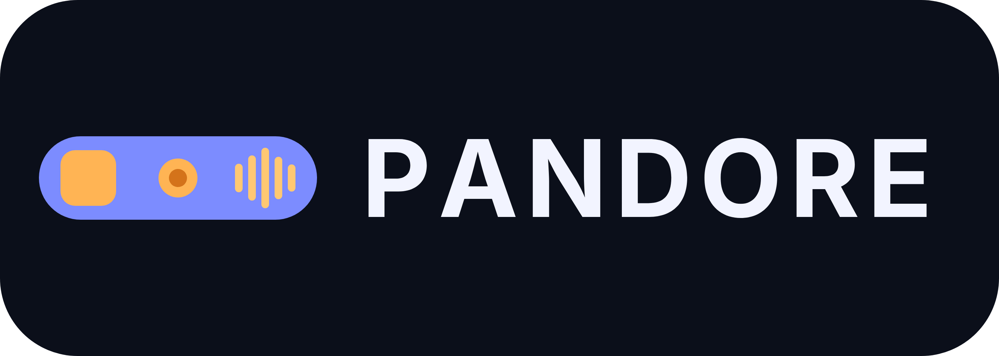

<picture>
  <source media="(prefers-color-scheme: dark)" srcset="https://raw.githubusercontent.com/D1OSCUR3S/.github/main/profile/assets/logo/d1oscur3s-logo-wordmark-transparent.png" />
  
</picture>

**Two developers, one organization, zero over-engineering.**

  
  
  

---

## 👋 About us

We are two developers who build things for our own needs, and share them here so others can use, learn from, or improve them.

| | Who | Focus |
|---|---|---|
| 🤖 | **Ilan** - [@Ilan-LP](https://github.com/Ilan-LP) | Artificial Intelligence (LLMs, AI APIs, automation) |
| 🛡️ | **Valentin** - [@ValentinBassot](https://github.com/ValentinBassot) | Cybersecurity |

Between us, we cover the AI side and the security side of the projects we care about.

## 🏛️ Why "D1OSCUR3S"

The name is a leetspeak take on **Dioscures** (*Dioskouroi*). In Greek mythology, the Dioscuri are Castor and Pollux, twin sons of Zeus, known for their inseparable bond and for protecting travelers and sailors. Two brothers, one mission: that is exactly how we work.

Our logo shows them as two stars: Castor in blue, Pollux in orange.

## 📦 Our projects

Like the organization itself, every project is named after a figure or a place from Greek mythology, usually under its French name. We pick a name whose story echoes what the project does.

| Project | Named after | What it is | Status |
|---|---|---|---|
|  | Coeus (*Céos*), the Titan of intellect and foresight | Modular, self-hosted AI assistant that manages your calendar and todos | 🚧 In progress |
|  | Pandora (*Pandore*), whose box released everything it held once opened | Modular macOS notch app where every feature is an addon you can install from a file, a folder or a Git repo | 🚧 In progress |

## 🚀 What we do

- Build **personal tools** that solve real problems we run into
- Experiment with **AI-powered** workflows and integrations
- Explore **security** tooling and defensive practices
- Automate repetitive tasks with **scripts and small services**
- Publish what is useful so it is available to anyone who needs it

## 🧭 How we work

- **Small scope, fast iteration**: ship something working, then improve it
- **Clean, readable code** that is easy to come back to
- **Pragmatism over hype**: no over-engineering, no unnecessary abstractions
- **Open by default**: projects are shared here as they mature

## 🛠️ Tech stack

| Area | Tools |
|---|---|
| Languages | JavaScript, TypeScript, Python, HTML/CSS |
| Frontend | React |
| AI | LLM APIs, prompt engineering, agents |
| Security | Cyber tooling, defensive analysis |
| Automation | Scripting, CI/CD, task automation |

## 📫 Contact

Interested in a collaboration, an idea, or a question about one of our projects? Open an issue on the relevant repository or reach out to either of us directly through our GitHub profiles above.

---

Made by two friends who like building useful things.

